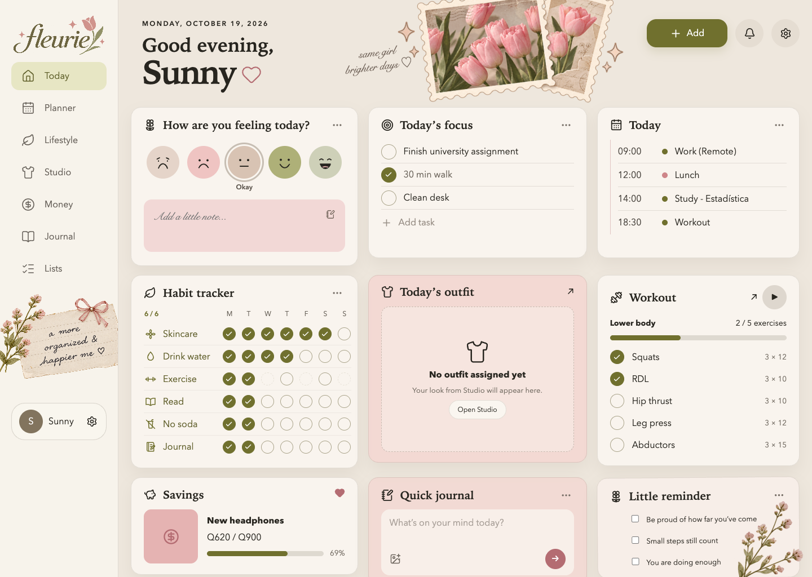
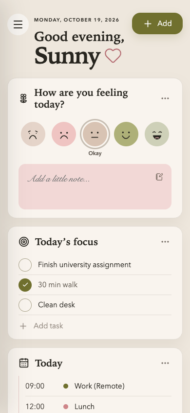

# Fleurie Personal Planner

Fleurie is a browser-based personal planner that brings daily planning, wellbeing, wardrobe organization, finances, journaling, and lists into one calm, vintage-floral workspace.

> Portfolio status: active personal project. The repository is intended for review and demonstration; it is not currently distributed as an open-source project.

[Open the live GitHub Pages demo](https://sunnysideup-webdev.github.io/fleurie-personal-planner/)

## Preview

### Desktop



### Mobile



## Highlights

- **Today:** an integrated daily view for tasks, reminders, habits, mood, routines, a quick journal, a selected outfit, and a featured savings goal.
- **Planner:** tasks, reminders, planning goals, and a calendar.
- **Lifestyle:** habit tracking and statistics, mood history, routines, workouts, and fitness information.
- **Studio:** a digital closet and free-form outfit canvas with movable, resizable, rotatable, and layered pieces, plus saved Lookbook previews.
- **Money:** expenses, category budgets, savings goals, favorites, and monthly summaries.
- **Journal:** long-form entries with tags, prompts, freely positioned photos and stickers, layering, resizing, and opacity controls.
- **Lists:** shopping items, wishlists, personal lists, and notes.

## Technology

- Next.js 16 App Router
- React 19
- TypeScript in strict mode
- `lucide-react` icons
- Global CSS and static PNG/SVG artwork
- Browser `localStorage` persistence
- Installable Progressive Web App (PWA) with offline support for previously opened pages

Fleurie currently has no backend, user accounts, analytics, or cloud database.

## Install as an app

Fleurie includes a web app manifest, dedicated application icons, and a service worker. Once it is deployed over HTTPS, supported browsers can install it as a **Progressive Web App (PWA)** on a computer or mobile home screen.

Previously opened pages and their static resources are cached for offline use. Planner content continues to live in the browser's `localStorage`; installing the PWA does not add cloud synchronization or remote backup.

A PWA still requires web hosting. Fleurie is deployed through GitHub Pages and does not depend on Vercel. Every push to `main` runs a clean static build and publishes the result through the workflow in `.github/workflows/deploy-pages.yml`.

## Getting started

### Requirements

- Node.js 20.9 or newer
- npm

### Installation

```bash
npm install
npm run dev
```

Open [http://localhost:3000](http://localhost:3000) in a browser.

### Production check

```bash
npm run build
npm run start
```

There is currently no automated test or lint script. `npm run build` performs the available TypeScript and Next.js production checks.

## Data and privacy

All planner records and uploaded images remain in the browser's `localStorage`. They are not sent to a server by this application.

This also means:

- data does not automatically sync between browsers or devices;
- private/incognito sessions may discard it;
- clearing site data removes it;
- uploaded images count toward the browser's storage limit; and
- local data is not encrypted by Fleurie.

If the browser storage limit is reached, Fleurie keeps running and shows a warning that the latest changes could not be saved.

Fleurie does not yet include a built-in backup or export feature. Do not enter highly sensitive information into a public or shared browser profile.

See [Data storage](docs/DATA_STORAGE.md) for the persistence map and compatibility rules.

## Project structure

```text
app/
  page.tsx          Today dashboard
  planner/          Tasks, reminders, planning, and calendar
  lifestyle/        Habits, mood, routines, and statistics
  studio/           Closet, outfit creator, and Lookbook
  money/            Expenses, budgets, and savings
  journal/          Entries, prompts, tags, photos, and stickers
  lists/            Shopping, wishlist, personal lists, and notes
  globals.css       Shared visual system and page styles
public/              Fleurie branding and decorative artwork
references/          Visual references retained for the design history
wireframes/          Early interface concepts and layout exploration
docs/                Architecture, persistence, assets, and release notes
```

The feature providers are composed in `app/layout.tsx`. Most feature data types and persistence logic live in each feature's `_data/` directory.

## Documentation

- [Architecture](docs/ARCHITECTURE.md)
- [Data storage](docs/DATA_STORAGE.md)
- [Visual assets](docs/ASSETS.md)
- [Design tokens](docs/design-tokens.md)
- [Product roadmap](docs/roadmap.md)
- [Public release checklist](docs/RELEASE_CHECKLIST.md)
- [Contributing](CONTRIBUTING.md)
- [Security](SECURITY.md)
- [Third-party notices](THIRD_PARTY_NOTICES.md)
- [Changelog](CHANGELOG.md)

Development assistants should also read `AGENTS.md`; `CLAUDE.md` imports the same canonical instructions.

## License

Copyright © 2026 Sharon (Sunny) Consuegra. All rights reserved.

The source code and project assets are published for portfolio review only. No permission is granted to copy, modify, redistribute, sublicense, or sell them. See [LICENSE](LICENSE) for the full terms.
