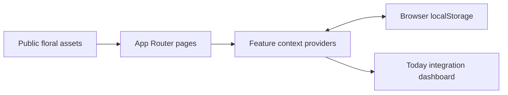

# Architecture

## Overview

Fleurie is a client-heavy Next.js App Router application. Routes render the interface, feature-level React providers own state, and browser `localStorage` provides persistence.

There is no server database, API layer, authentication service, or account model.

## Route areas

| Area | Route root | Responsibility |
| --- | --- | --- |
| Today | `/` | Cross-feature daily overview and quick actions |
| Planner | `/planner` | Tasks, reminders, goals, and calendar |
| Lifestyle | `/lifestyle` | Habits, statistics, mood, routines, workouts, and fitness |
| Studio | `/studio/outfits` | Closet, outfit canvas, Today assignment, and Lookbook |
| Money | `/money` | Transactions, budgets, monthly summary, and savings |
| Journal | `/journal` | Entries, prompts, tags, photos, and stickers |
| Lists | `/lists` | Shopping, wishlist, personal lists, and notes |

## State organization

`app/layout.tsx` composes all feature providers so Today and feature routes can access the same in-memory state. Types, starter data, storage hydration, and mutations normally live in a feature's `_data/use-*-data.ts` file.

Provider persistence follows this lifecycle:

1. Mount the client provider.
2. Read and parse its existing storage record.
3. Normalize legacy or optional fields when necessary.
4. Mark hydration as ready.
5. Persist subsequent state changes.

The ready step is important: writing starter state before reading storage can erase a user's saved data.

## Today integration

Today is not a second data store for every feature. It reads from feature providers and the calendar/outfit assignment keys to show selected or date-relevant data. A feature change that affects Today should be verified in both locations.

Examples include:

- savings favorites and their images;
- outfits dated for today or explicitly assigned to today;
- scheduled habits and active routines;
- planner tasks and reminders;
- mood entries; and
- quick journal entries.

## Interactive canvases

Studio outfits and Journal entries store visual placement information instead of flattening the composition into a screenshot. Their previews must preserve position, size, rotation, opacity, z-order, borders, decorations, and background color.

`app/studio/_components/outfit-miniature.tsx` is the shared renderer for saved outfit previews in Today and Lookbook.

## Styling and assets

Most styling is centralized in `app/globals.css`. Broad selector changes can affect unrelated routes, so search for all consumers and verify responsive behavior.

Static branding and decorative compositions are stored in `public/`. User-uploaded content is stored as data URLs in browser storage and is not written into the repository.

## Progressive Web App layer

`app/manifest.ts` defines install metadata and icon references. A small client component in `app/_components/service-worker-registration.tsx` registers `public/sw.js` only in production.

The service worker precaches the minimum application shell and uses runtime caching for same-origin pages and static resources. Navigation remains network-first, with cached pages or Today as the offline fallback. User planner records remain in `localStorage` and are not moved into service-worker caches.
